# Entregable #3 — Implementación técnica

**Propósito:** construir e integrar la solución diseñada en el Entregable #2 y demostrar que red, virtualización, contenedores, monitoreo, observabilidad y automatización funcionan de manera coordinada.

El documento sigue el orden del contenido obligatorio de la *Guía de contenido, rúbrica y criterios de aceptación* del Entregable #3. Las secciones 1 a 9 corresponden una a una a los nueve puntos de la guía:

| Punto de la guía | Sección | Criterio de la rúbrica | Peso |
|---|---|---|---|
| Infraestructura base | 1 | Infraestructura y red funcional | 20 % |
| Red | 2 | Infraestructura y red funcional | 20 % |
| Contenedores | 3 | Contenedores y aplicación | 15 % |
| Zabbix | 4 | Zabbix | 20 % |
| Grafana | 5 | Grafana | 15 % |
| Automatización | 6 | Automatización y alertamiento | 15 % |
| Alertamiento | 7 | Automatización y alertamiento | 15 % |
| RPA | 8 | RPA / experiencia de usuario | 10 % |
| Evidencias técnicas | 9 y Anexo A | Evidencia y orden técnico | 5 % |

Después vienen lo que el profesor pidió además de la guía (sección 10), los criterios y pruebas de aceptación A-01 a A-09 (sección 11), las respuestas a las preguntas orientadoras (12), las incidencias y las diferencias con el diseño (13) y lo que queda pendiente (14).

Todo lo que aquí se describe está construido sobre el equipo real del laboratorio y probado entre el 12 y el 13 de octubre de 2026. Cada afirmación indica cómo se comprobó; lo que no se ha probado se dice.

## Resumen del estado

La plataforma está en pie sobre el router, el switch y el servidor que presta la universidad. En el servidor corren **siete máquinas virtuales**. MS Motos atiende en dos ambientes, Zabbix vigila todas las capas, Grafana muestra cinco tableros con esos datos, n8n recupera solo lo que tiene una causa conocida y avisa por Telegram, y un robot recorre la aplicación como un cliente cada cinco minutos.

| Elemento | Estado al 13 de octubre de 2026 |
|---|---|
| VLAN | 4 en uso (20, 30, 40, 99) y la nativa 999 |
| Máquinas virtuales | 7 encendidas: cinco Ubuntu 24.04 y dos Windows Server 2022 |
| Ambientes de MS Motos | 2: Linux en contenedores y Windows como servicio |
| Hosts en Zabbix | 15, con 1 258 ítems |
| Triggers propios del proyecto | 16 (T01, T03 a T08, T12 a T17 y las variantes de Windows) |
| Tableros de Grafana | 5; los 34 paneles con consulta traen datos |
| Fallas que se recuperan solas | 3: contenedor detenido, Nginx detenido y servicio de Windows detenido |
| Recorridos del robot | 2, cada uno contra las dos instancias |

| Prueba de aceptación | Estado |
|---|---|
| A-01 Acceso de un usuario a la aplicación | **Pendiente**: falta abrirla desde la computadora de usuario |
| A-02 a A-09 | **Cumplen**, con la evidencia de la sección 11 |

## 1. Infraestructura base

### 1.1 Servidor e hipervisor

| Dato | Valor |
|---|---|
| Servidor | Dell PowerEdge R450 |
| Procesador | Intel Xeon Silver 4314, 16 núcleos y 32 hilos |
| Memoria | 64 GB |
| Disco | 2,2 TB en un volumen de la controladora PERC H345 |
| Hipervisor | Proxmox VE 9.2.2, núcleo 7.0.2-6-pve |
| Red | Dos tarjetas en uso: una al troncal de SW1 (red del proyecto) y otra a la red de la universidad (administración remota) |

El servidor traía un Ubuntu de otro grupo con credenciales desconocidas. Se reinstaló desde cero con Proxmox VE el 12 de octubre.

Con las siete máquinas virtuales encendidas el servidor usa 26 de sus 64 GB de memoria y el 3 % del almacenamiento de VM. No hizo falta ninguno de los recortes de memoria previstos en la sección 4.4 del Entregable #2.

### 1.2 Máquinas virtuales

| ID | VM | Dirección | Sistema | vCPU | Memoria | Disco | Qué corre |
|---|---|---|---|---|---|---|---|
| 111 | `vm-app` | 10.10.30.11 | Ubuntu 24.04 | 2 | 4 GB | 40 GB | MS Motos en contenedores, Nginx |
| 112 | `vm-zabbix` | 10.10.30.12 | Ubuntu 24.04 | 2 | 4 GB | 60 GB | Zabbix 7.0 y su base de datos |
| 113 | `vm-grafana` | 10.10.30.13 | Ubuntu 24.04 | 1 | 2 GB | 20 GB | Grafana 12.4 |
| 114 | `vm-n8n` | 10.10.30.14 | Ubuntu 24.04 | 2 | 2 GB | 20 GB | n8n 2.40 |
| 115 | `vm-rpa` | 10.10.30.15 | Ubuntu 24.04 | 2 | 4 GB | 30 GB | Robot Framework y Chromium |
| 116 | `vm-app-win` | 10.10.30.16 | Windows Server 2022 | 2 | 4 GB | 60 GB | MS Motos como servicio, MySQL |
| 117 | `vm-dc` | 10.10.30.17 | Windows Server 2022 | 2 | 4 GB | 60 GB | Active Directory y DNS |

Las siete están en la VLAN 30 y arrancan solas con el servidor. Ninguna se creó a mano: salen de scripts versionados, que también sirven para rehacerlas.

| VM | Cómo se crea | Tiempo |
|---|---|---|
| Las cinco Linux | `infra/proxmox/crear-vms.sh`: imagen oficial de Ubuntu para la nube, configurada por cloud-init (nombre, dirección, usuario y llave SSH) | Minutos |
| Las dos Windows | `infra/proxmox/crear-vms-windows.sh`: instalación desatendida con un archivo de respuestas | 14 y 13 minutos, sin tocar la consola |

A las VM Linux solo se entra con llave SSH; no tienen contraseña. Las VM Windows aceptan SSH con llave y escritorio remoto, solo desde las VLAN 30 y 40.

<figure>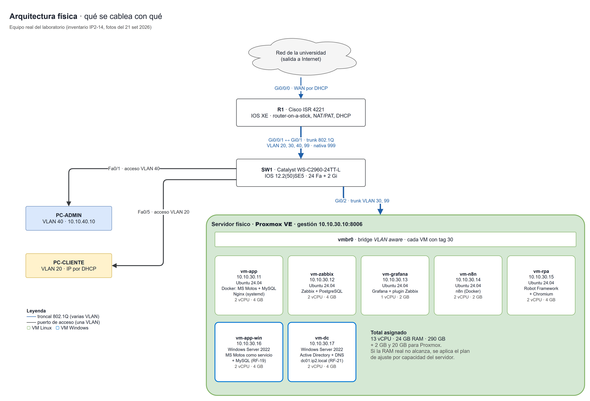<figcaption>Figura 1 · Arquitectura física construida: el router, el switch, el servidor y las siete máquinas virtuales. Es el diagrama del Entregable #2; lo implementado lo respeta.</figcaption></figure>

### 1.3 Administración remota

El laboratorio se administra a distancia desde el 12 de octubre. El servidor tiene dos caminos de red:

| Tarjeta | Conectada a | Para qué |
|---|---|---|
| `nic2` | Red de la universidad | Salida de Tailscale. No depende del router ni del switch del proyecto |
| `nic3` | SW1 Gi0/2, troncal | Red del proyecto: Proxmox y las VM en la VLAN 30 |

Tailscale publica las cuatro redes del proyecto solo a los equipos de la cuenta del equipo. La tarjeta `nic2` tiene un cortafuegos que no acepta conexiones entrantes ni reenvía tráfico, para que el servidor no sirva de atajo que esquive al router.

**Prueba de reinicio:** se reinició el servidor sin tocar nada más. Volvió solo con sus direcciones, el cortafuegos, Tailscale y el panel activos, sin servicios fallidos.

### 1.4 Respaldos

Proxmox respalda las VM en un volumen aparte de 300 GB, con la frecuencia del diseño: las críticas (`vm-app`, `vm-zabbix`, `vm-dc`) todos los días con 3 copias, `vm-app-win` todos los días con 2, y el resto una vez por semana.

**Prueba:** se respaldó el controlador de dominio (1 minuto 55 segundos, 5,16 GB), se restauró en una VM aparte sin red (69 segundos) y Windows arrancó hasta la pantalla de inicio de sesión. Las copias quedan en los mismos discos del servidor: protegen de dañar una VM, no de perder el servidor.

## 2. Red

### 2.1 Equipos y segmentación

| Equipo | Modelo | Sistema | Función |
|---|---|---|---|
| R1 | Cisco ISR 4221 | IOS XE 17.12.03a | Enrutamiento entre VLAN, NAT, DHCP de usuarios y listas de acceso |
| SW1 | Cisco Catalyst WS-C2960-24TT-L | IOS 15.0(2)SE11 | VLAN, troncales y controles de capa 2 |

| VLAN | Nombre | Red | Quién está ahí |
|---|---|---|---|
| 20 | USUARIOS | 10.10.20.0/24 | Computadoras de usuario; dirección por DHCP (.100 a .200) |
| 30 | SERVIDORES | 10.10.30.0/24 | El servidor Proxmox y las siete VM |
| 40 | ADMINISTRACION | 10.10.40.0/24 | La computadora de administración, con dirección fija |
| 99 | GESTION | 10.10.99.0/24 | La gestión del switch |
| 999 | NATIVA | — | Sin uso; es la nativa de los troncales |

| Puerto de SW1 | Modo | VLAN |
|---|---|---|
| Gi0/1 | Troncal hacia R1 | 20, 30, 40, 99 |
| Gi0/2 | Troncal hacia el servidor | 30 y 99 |
| Fa0/1 a Fa0/4 | Acceso | 40 (Administración) |
| Fa0/5 a Fa0/12 | Acceso, con seguridad de puerto (máximo 2 direcciones) | 20 (Usuarios) |

R1 enruta entre las VLAN con una subinterfaz por cada una (*router-on-a-stick*), entrega direcciones a los usuarios por DHCP y traduce todo el tráfico de salida con la dirección de su WAN (NAT con sobrecarga, o PAT). La WAN recibe su dirección de la red de la universidad.

En SW1 están activos, además, DHCP snooping e inspección de ARP en la VLAN de usuarios y control de tormentas. Las configuraciones aplicadas son las de `red/router/R1-4221.txt` y `red/switch/SW1-2960.txt`, con las contraseñas y la comunidad SNMP reales, que no están en el repositorio.

### 2.2 Qué puede hacer cada red

| Desde | Puede | No puede |
|---|---|---|
| Usuarios (VLAN 20) | Abrir la aplicación en sus dos instancias (puertos 80 y 443) y salir a Internet | Alcanzar los demás servidores, la red de administración ni la gestión de los equipos |
| Administración (VLAN 40) | Administrar todo: servidor, VM, router y switch | — |
| Servidores (VLAN 30) | Salir a Internet y consultar por SNMP al router y al switch (solo Zabbix) | Iniciar conexiones hacia los usuarios |

### 2.3 Pruebas desde una computadora de usuario

PC-CLIENTE: computadora del laboratorio conectada a SW1 Fa0/5 (VLAN 20), con la red en automático.

| # | Prueba | Esperado | Resultado |
|---|---|---|---|
| V1 | `ipconfig` | Dirección por DHCP entre .100 y .200 | `10.10.20.100`, puerta de enlace `10.10.20.1` |
| V3 | `ping 10.10.30.10` (servidores) | Bloqueado | Bloqueado por el router |
| — | Abrir el panel de Proxmox | No abre | No abre: tiempo de espera agotado |
| V4 | `ping 10.10.40.10` (administración) | Bloqueado | Bloqueado por el router |
| V5 | `ping 10.10.99.2` (gestión del switch) | Bloqueado | Bloqueado por el router |
| V8 | `ping 8.8.8.8` | Responde por NAT | Responde, 4 de 4 |

En las pruebas bloqueadas quien contesta es el router ("Destination net unreachable"): es la lista de acceso de usuarios rechazando el paquete.

| V1 · El usuario recibe su dirección por DHCP | V3 · Los servidores están bloqueados para el usuario |
|---|---|
| 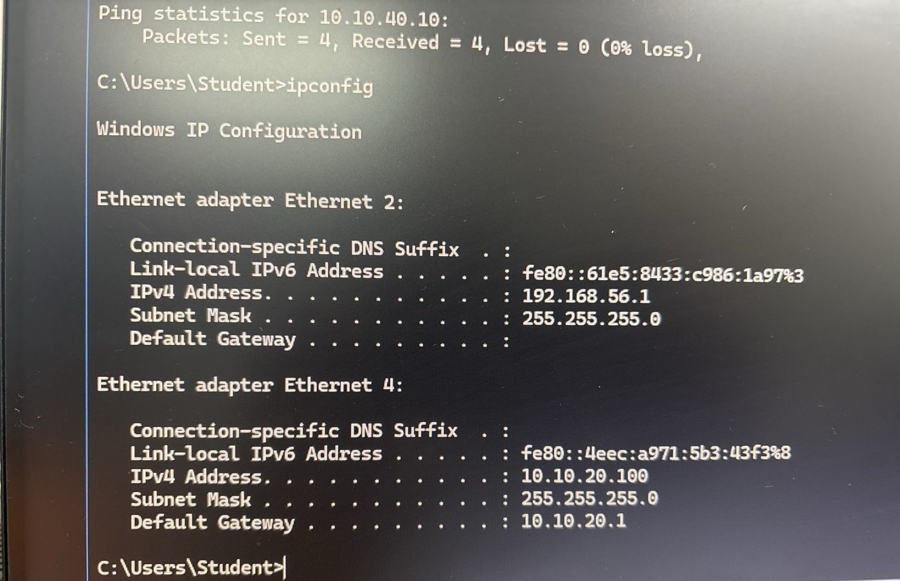 | 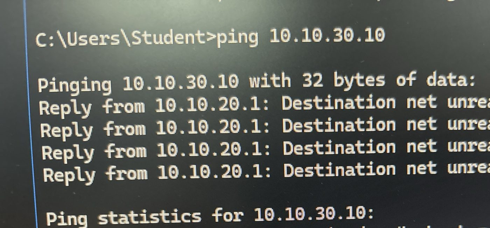 |

**V2, abrir la aplicación desde PC-CLIENTE, no se ha hecho todavía.** El día de la visita la aplicación aún no estaba desplegada. La lista de acceso ya permite ese tráfico y la aplicación responde desde la red de servidores, pero la prueba desde la computadora de usuario está pendiente (ver A-01).

### 2.4 Pruebas desde la computadora de administración

PC-ADMIN: computadora del laboratorio conectada a SW1 Fa0/1 (VLAN 40), con la dirección fija `10.10.40.10`.

| # | Prueba | Resultado |
|---|---|---|
| V6 | `ping` al servidor, a la gestión del switch y a PC-CLIENTE | Responden los tres, 4 de 4 |
| — | Abrir el panel de Proxmox | Abre y permite iniciar sesión |
| V7 | SSH a SW1 | Entra |
| V9 | SSH a R1 y `show ip nat translations` | 122 traducciones, con origen en las dos computadoras, todas saliendo con la dirección de la WAN |

Las mismas tres redes que el usuario tiene bloqueadas responden desde Administración, y el mismo panel que al usuario no le abre aquí sí carga.

| El panel de Proxmox abre desde Administración | V9 · Traducciones de NAT en R1 |
|---|---|
| 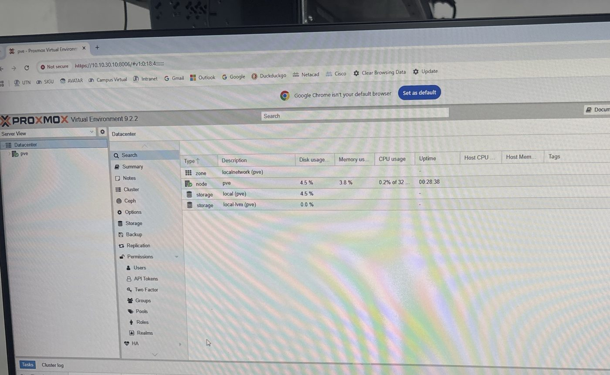 | 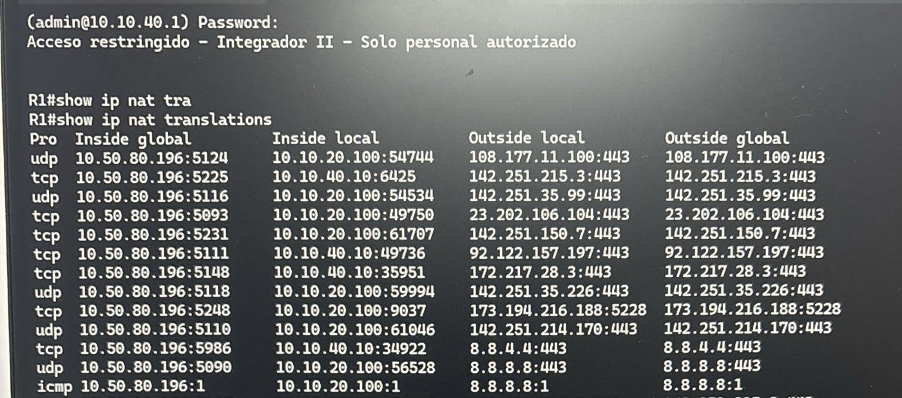 |

Las 16 fotos de estas pruebas están en `docs/evidencias/e3/red/`.

## 3. Contenedores

### 3.1 Cómo corre la aplicación

MS Motos es la aplicación de Integrador I: un taller de motos con portal de clientes, hecha con Ionic/Angular, Express y MySQL. En `vm-app` corre con Docker Compose (`app/docker-compose.yml`):

| Componente | Cómo corre | Publicado en |
|---|---|---|
| `msmotos-app` | Contenedor. Una sola imagen sirve la API y el portal web, sin privilegios de root | Solo en `127.0.0.1:3000` |
| `msmotos-db` | Contenedor con MySQL 8.4 | Sin puerto publicado: solo lo alcanza la aplicación |
| Nginx | Servicio del sistema en la VM, no contenedor | Puerto 80, hacia la red |

Nginx va fuera de los contenedores a propósito: así la demostración tiene un **servicio detenido** (Nginx) y un **contenedor detenido** (`msmotos-app`) como fallas distintas.

La imagen se construye en la propia VM desde el `Dockerfile` del repositorio, en tres etapas, para que la imagen final no cargue las herramientas de compilación. `infra/vm-app/desplegar.sh` instala Docker, construye, levanta y comprueba. Los secretos se generan al azar en la VM y viven solo en su archivo `.env`.

### 3.2 Pruebas

| Prueba | Resultado |
|---|---|
| Estado de los dos contenedores | En ejecución y `healthy` |
| `http://10.10.30.11/api/health` por Nginx | HTTP 200, `{"ok":true}` |
| `http://10.10.30.11/` | HTTP 200, portal "MS Motos · Taller" |
| Inicio de sesión de las cuentas del taller | HTTP 200, con su rol |
| Inicio de sesión con contraseña incorrecta | HTTP 401 |

### 3.3 Persistencia

Los datos de MySQL viven en el volumen `msmotos-db-data`, fuera del contenedor.

**Prueba** del 13 de octubre: se contaron los registros, se eliminaron los dos contenedores y su red con `docker compose down` (sin borrar el volumen), se volvieron a crear con `docker compose up -d` y se contaron de nuevo.

| Momento | Usuarios | Clientes | Citas |
|---|---|---|---|
| Antes de eliminar los contenedores | 3 | 1 | 24 |
| Después de volver a crearlos | 3 | 1 | 24 |

La aplicación volvió a responder 12 segundos después, con los mismos datos.

## 4. Zabbix

Zabbix 7.0.30 corre en `vm-zabbix`, con PostgreSQL 16, en contenedores. Toda su configuración la crea `infra/vm-zabbix/configurar-zabbix.py` por la API, así que se puede repetir y queda versionada.

### 4.1 Qué se monitorea, por capa

| Capa de la guía | Host en Zabbix | Método | Ítems |
|---|---|---|---|
| Servidor | `proxmox` | API de Proxmox con un token de solo lectura, y ping | 105 |
| Máquinas virtuales Linux | `vm-app`, `vm-zabbix`, `vm-grafana`, `vm-n8n`, `vm-rpa` | Zabbix agent 2 | 230 en `vm-app`, 75 en las demás |
| Máquinas virtuales Windows | `vm-app-win`, `vm-dc` | Zabbix agent 2 | 107 y 116 |
| Contenedores | `vm-app` | Plugin de Docker del agente: estado, CPU y memoria de cada contenedor | Incluidos en `vm-app` |
| Servicios | `vm-app`, `vm-app-win`, `vm-dc` | Estado de Nginx, del servicio `MSMotos` y de los servicios del dominio | Incluidos en cada VM |
| Aplicación | `msmotos-web`, `msmotos-web-win` | Escenario web cada 30 segundos: disponibilidad y tiempo de respuesta | 9 cada uno |
| Router | `r1` | SNMP v2c de solo lectura | 96 |
| Switch e interfaces | `sw1` | SNMP v2c de solo lectura | 245 |
| Experiencia del cliente | `msmotos-rpa-linux`, `msmotos-rpa-windows` | Resultados que envía el robot | 21 cada uno |
| Automatización | `automatizacion` | Resultados que envía n8n | 17 |

Son 15 hosts y 1 258 ítems. Por SNMP Zabbix descubrió las 30 interfaces del router y del switch, con su estado, tráfico, errores y descartes. El router y el switch solo responden SNMP a `vm-zabbix` y con la comunidad correcta.

Una limitación conocida: en R1, los contadores de errores y descartes de las subinterfaces no tienen dato, porque IOS XE no los publica por subinterfaz. Los de la interfaz física sí llegan.

Del servidor, Zabbix ve el nodo (CPU, memoria, disco, tiempo encendido), cada una de las siete VM vista desde el hipervisor, y el almacenamiento.

### 4.2 Triggers del proyecto

Además de los que traen las plantillas, se crearon 16 triggers propios. La etiqueta `remediation` le dice a n8n si hay algo que hacer.

| Trigger | Condición | Severidad | Acción automática |
|---|---|---|---|
| T01 Contenedor `msmotos-app` detenido | Sin estado *running* durante 1 minuto | Alta | Iniciar el contenedor |
| T03 Servicio Nginx detenido | Sin estado `active` durante 1 minuto | Alta | Reiniciar Nginx |
| T03-W Servicio `MSMotos` detenido (Windows) | Fuera de ejecución durante 1 minuto | Alta | Iniciar el servicio |
| T04 y T04-W La aplicación no está disponible | El chequeo web falla 2 veces seguidas | Desastre | Ninguna |
| T05 y T05-W La aplicación responde lento | Promedio mayor a 2 s en 5 minutos | Advertencia | Ninguna |
| T06 CPU alta, en las cinco VM Linux | Más de 85 % y más de 95 %, promedio de 5 minutos | Advertencia y alta | Ninguna |
| T07 Memoria alta, en las cinco VM Linux | Más de 85 % y más de 95 %, promedio de 5 minutos | Advertencia y alta | Ninguna |
| T08 Disco lleno, en las cinco VM Linux | Más de 80 % y más de 90 % | Advertencia y alta | Ninguna |
| T12 El cliente no pudo completar un recorrido | Resultado del robot = 0; dice en qué paso | Alta | Ninguna |
| T13 Recorrido lento | Consulta mayor a 10 s o agendar mayor a 20 s | Advertencia | Ninguna |
| T14 El robot dejó de reportar | Sin datos en 15 o 75 minutos | Advertencia | Ninguna |
| T15 Servicio del dominio caído | Active Directory, DNS o Kerberos detenido 1 minuto | Alta | Ninguna |
| T16 Muchos inicios de sesión fallidos | Más de 10 en 5 minutos | Advertencia | Ninguna |
| T17 Cuenta del dominio bloqueada | Cualquier bloqueo | Advertencia | Ninguna |

El diseño del Entregable #2 numeraba 24 triggers. Están hechos los 16 de esta tabla; faltan los de la recuperación de red (interfaz y puerto caídos) y algunos de capacidad de red, que van con el flujo de recuperación de red (sección 14).

### 4.3 Prueba de detección

Se detuvo el contenedor de la aplicación, sin automatización todavía, para medir cuánto tarda Zabbix en verlo.

| Hora | Qué pasó |
|---|---|
| 20:10:39 | Se detiene `msmotos-app` |
| +73 s | Zabbix tiene abierto T01 (contenedor) y T04 (aplicación) |
| — | Durante la caída Nginx sigue arriba y el usuario recibe HTTP 502 |
| 20:12:45 | Se inicia el contenedor a mano |
| +67 s | Zabbix cierra los problemas |

La detección quedó dentro del requisito de menos de 2 minutos (RNF-01).

## 5. Grafana

Grafana 12.4.3 corre en `vm-grafana` y lee Zabbix con un usuario de solo lectura. Los cinco tableros se cargan solos desde `monitoreo/grafana/`, donde está su exportación en JSON.

| Tablero | Para quién | Qué responde |
|---|---|---|
| General (ejecutivo) | Quien necesita saber si el servicio está bien | ¿Está arriba la aplicación? ¿Qué problemas hay abiertos? |
| Técnico (infraestructura) | Quien opera la plataforma | CPU, memoria y disco del servidor, de cada VM y de cada contenedor |
| Red | Quien opera la red | Estado, tráfico, errores y latencia de R1, SW1 y sus interfaces |
| Experiencia del usuario | Quien cuida el servicio al cliente | ¿Cuánto tarda cada paso de lo que hace un cliente? |
| Automatización (n8n y RPA) | Quien revisa lo que el sistema hizo solo | ¿Qué recuperó n8n, cuánto tardó y qué rechazó? |

`infra/vm-grafana/verificar-tableros.py` ejecuta las consultas de todos los paneles. Resultado del 13 de octubre: **34 paneles con datos, ninguno vacío y ninguna consulta con error**. Los otros 6 son listas de problemas, que solo se resuelven en el navegador y se ven en las capturas.

Las capturas son del 13 de octubre de 2026 a las 20:25, tomadas del Grafana del laboratorio.

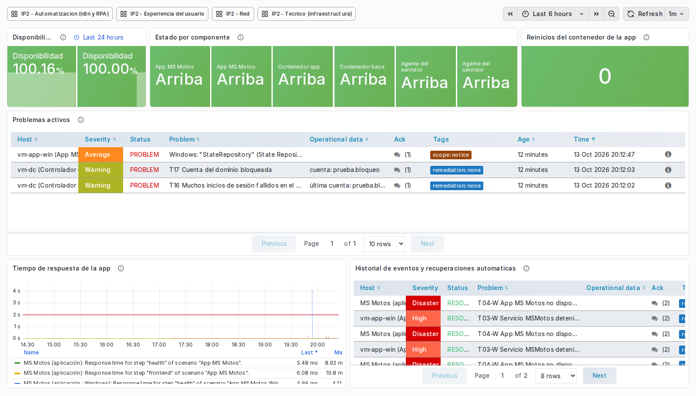

*Tablero General: disponibilidad, estado por componente, problemas activos e historial de recuperaciones. Los problemas que aparecen son de las pruebas de ese día.*

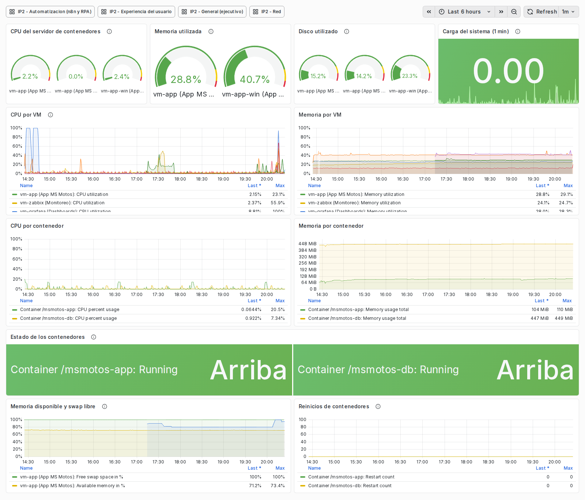

*Tablero Técnico: servidor, máquinas virtuales y contenedores.*

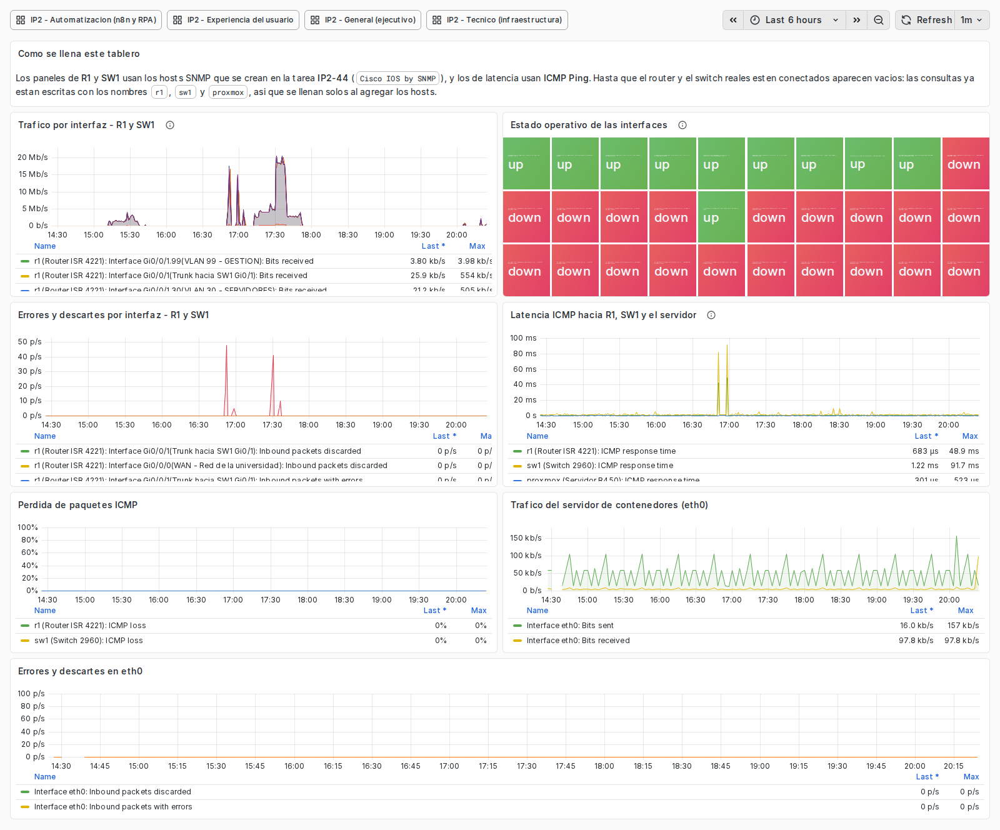

*Tablero de Red: interfaces de R1 y SW1, errores, descartes y latencia.*

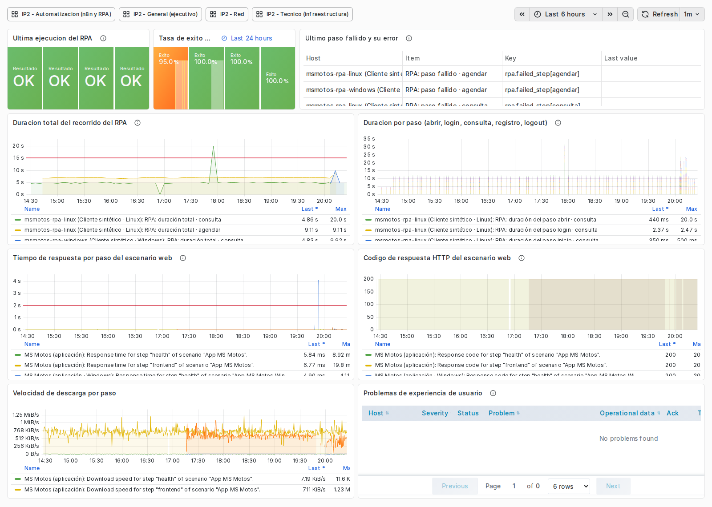

*Tablero de Experiencia del usuario: lo que mide el robot en cada paso.*

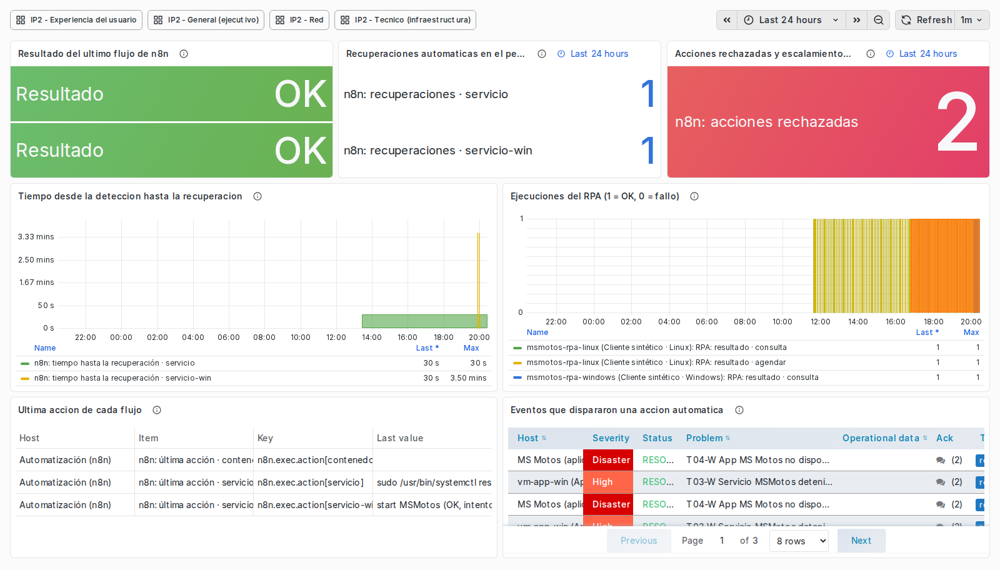

*Tablero de Automatización: resultado del último flujo, recuperaciones por tipo, acciones rechazadas y tiempo de la detección a la recuperación.*

## 6. Automatización

### 6.1 Cómo funciona

n8n 2.40.2 corre en `vm-n8n`. Zabbix le avisa cada problema del proyecto por un webhook. El flujo `automatizacion/n8n/recuperacion-zabbix.json` decide, actúa por SSH, deja constancia en el evento de Zabbix, avisa por Telegram y reporta su propia ejecución a Zabbix.

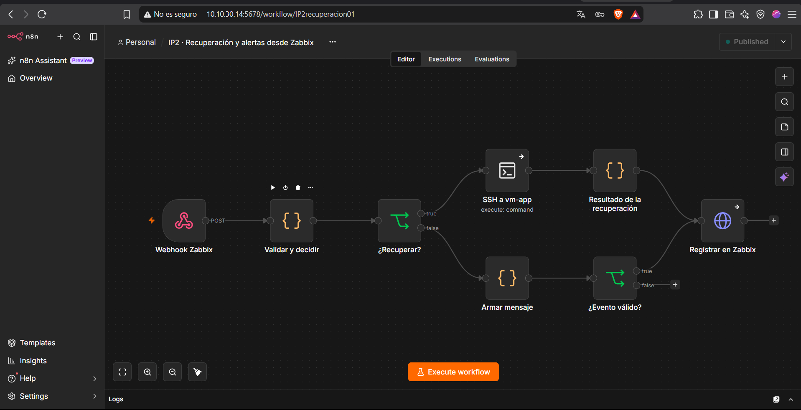

*El flujo en n8n, publicado. Esta captura es del 12 de octubre; después se le agregaron el aviso por Telegram, el reporte a Zabbix y la rama de Windows (15 nodos en total).*

| Falla | Trigger | Qué hace n8n |
|---|---|---|
| Contenedor de la aplicación detenido | T01 | `docker start msmotos-app` en `vm-app` |
| Nginx detenido | T03 | `systemctl restart nginx` en `vm-app` |
| Servicio de Windows detenido | T03-W | Inicia el servicio `MSMotos` en `vm-app-win` |

### 6.2 Controles

La automatización tiene límites para que no se convierta en un riesgo.

| Control | Cómo se cumple | Cómo se probó |
|---|---|---|
| Lista cerrada de acciones | El comando sale de una tabla dentro del flujo, nunca del texto que llega. En cada VM la cuenta `n8n-ops` solo puede ejecutar esos comandos | Con la cuenta se intentó listar contenedores, detener la base de datos y abrir una sesión de root: los tres rechazados. En Windows, otro comando responde "Accion no permitida" |
| Máximo tres intentos | Tres intentos por objetivo cada diez minutos; después no actúa y pide una persona | Visible en cada aviso: "intento 1 de 3" |
| Mínimo privilegio | `n8n-ops` no tiene contraseña, no es administradora y entra solo con llave, aceptada solo desde `vm-n8n` | Entrar con esa cuenta desde el servidor Proxmox: rechazado |
| Aviso autenticado | El webhook solo acepta avisos con el token de Zabbix | Aviso con token falso y el contenedor detenido: descartado, el contenedor siguió detenido |
| Constancia | n8n anota en el evento de Zabbix qué hizo y cómo salió | Visible en cada evento |

### 6.3 Pruebas de recuperación

**Contenedor detenido (12 de octubre):**

| Hora | Desde la parada | Qué pasó |
|---|---|---|
| 21:48:33 | 0 s | `docker stop msmotos-app` |
| 21:49:54 | 81 s | Zabbix abre T01 y avisa a n8n |
| 21:49:55 | 82 s | n8n ejecuta `docker start msmotos-app` |
| 21:49:57 | 84 s | El contenedor vuelve a estar en ejecución |
| 21:50:54 | 141 s | Zabbix cierra T01 y n8n anota "RESUELTO" |

**Nginx detenido (12 de octubre):**

| Hora | Desde la parada | Qué pasó |
|---|---|---|
| 21:56:24 | 0 s | `systemctl stop nginx` |
| 21:57:27 | 63 s | Zabbix abre T03 y avisa a n8n |
| 21:57:28 | 64 s | n8n ejecuta `systemctl restart nginx` |
| 21:57:29 | 65 s | Nginx activo |
| 21:57:57 | 93 s | Zabbix cierra T03 y n8n anota "RESUELTO" |

**Servicio de Windows detenido (13 de octubre):**

| Hora | Desde la parada | Qué pasó |
|---|---|---|
| 19:59:46 | 0 s | `Stop-Service MSMotos` |
| 20:00:55 | 69 s | Zabbix abre T03-W y avisa a n8n |
| 20:01:01 | 75 s | El servicio vuelve a estar en ejecución |
| 20:01 | — | Zabbix cierra T03-W; la aplicación responde 200 |

En las tres pruebas la detección tomó menos de 2 minutos (RNF-01) y la recuperación menos de 5 (RNF-02), sin intervención de una persona. Durante la prueba de Nginx el contenedor siguió en ejecución: Zabbix distinguió el servicio caído del contenedor caído.

### 6.4 Lo que la automatización reporta de sí misma

Al terminar cada ejecución n8n envía a Zabbix su resultado, cuánto tardó, qué comando corrió y cuánto pasó de la detección al cierre. Con eso se llena el tablero de Automatización (sección 5).

| Dato de la prueba de Nginx del 13 de octubre | Valor |
|---|---|
| Resultado | 1 (correcto) |
| Duración de la ejecución | 1 s |
| Acción | `sudo /usr/bin/systemctl restart nginx (OK, intento 1 de 3)` |
| Tiempo de la detección al cierre | 30 s |

## 7. Alertamiento

### 7.1 Canal

Los avisos llegan por **Telegram** al grupo *IP2 Alertas*, donde están los cinco integrantes. El bot es `@ip2_alertas_bot`; su token está solo en el `.env` de `vm-n8n`.

| Se avisa | No se avisa |
|---|---|
| Los triggers del proyecto, con cualquier severidad | Avisos de plantilla de severidad baja |
| Todo problema de severidad media, alta o desastre | Eventos que no traen el token de Zabbix |
| El cierre de cada uno ("RESUELTO") | |

Cada mensaje trae el estado, la severidad, el trigger, el host, la hora, el valor medido, la acción automática con su resultado si la hubo, y el número de evento de Zabbix.

El correo como segundo canal no se implementó. La guía pide "Telegram y/o correo".

### 7.2 Umbrales de capacidad

| Recurso | Advertencia | Alta | Dónde |
|---|---|---|---|
| CPU (T06) | Más de 85 %, promedio de 5 minutos | Más de 95 % | Las cinco VM Linux |
| Memoria (T07) | Más de 85 %, promedio de 5 minutos | Más de 95 % | Las cinco VM Linux |
| Disco (T08) | Más de 80 % | Más de 90 % | Las cinco VM Linux |
| Red | Enlace caído, errores y uso alto de ancho de banda | — | R1 y SW1, con los triggers de la plantilla de Cisco |

Estas alertas solo avisan: nadie amplía recursos en automático.

### 7.3 Prueba: superar un umbral y recibir el aviso

Se puso la CPU de `vm-grafana` al 100 % durante 8 minutos.

| Hora | Qué pasó |
|---|---|
| 14:36:14 | Empieza la carga |
| 14:41:30 | Zabbix abre "T06 CPU alta en vm-grafana (> 85 %)". Llega el aviso a Telegram |
| 14:42:30 | Zabbix abre "T06 CPU alta en vm-grafana (> 95 %)". Llega el aviso a Telegram |
| 14:44:14 | Termina la carga |
| 14:45 | Zabbix cierra los dos problemas y llegan los "RESUELTO" |

El aviso llegó 5 minutos y 16 segundos después de empezar la carga: es la ventana de 5 minutos del umbral más la lectura siguiente.

| Avisos de CPU alta | Aviso de una recuperación automática |
|---|---|
| 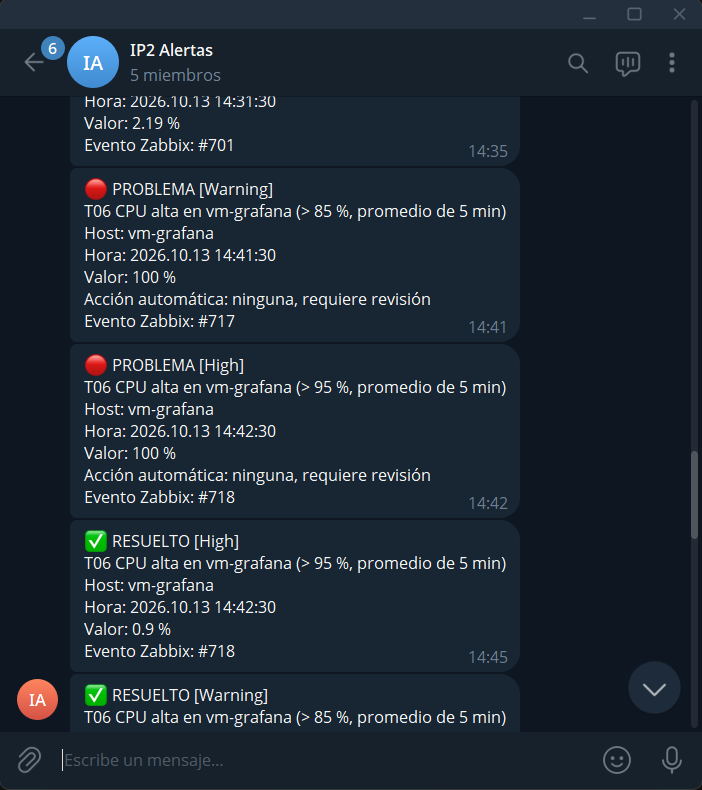 | 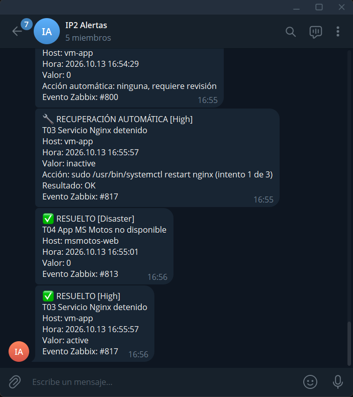 |

### 7.4 Consulta del estado

Cualquier integrante puede escribir `/estado` en el grupo. El bot responde con el estado de la aplicación, del robot, de los equipos y de los problemas abiertos. Solo atiende a ese grupo.

## 8. RPA

### 8.1 Qué hace el robot

El robot usa el portal de MS Motos como lo usaría un cliente: abre un navegador real (Chromium), escribe su correo y su contraseña y recorre las pantallas. Corre en `vm-rpa` con Robot Framework 7.5 y la librería Browser.

| Recorrido | Cada cuánto | Pasos | Operación real |
|---|---|---|---|
| Consulta | 5 minutos | abrir, login, inicio, motos, citas, logout | Entra, lee su resumen, abre el historial de su moto y revisa sus citas |
| Agendar | 30 minutos | abrir, login, elegir, reservar, verificar, cancelar, logout | **Reserva una cita, comprueba que quedó registrada y la cancela** |

El cliente es una cuenta propia del portal, con una moto y un servicio completado. La cita que el robot reserva queda cancelada, así que no ocupa la agenda del taller.

| Lo que ve el robot en "Mis Citas" | La cita que reserva, antes de cancelarla |
|---|---|
| 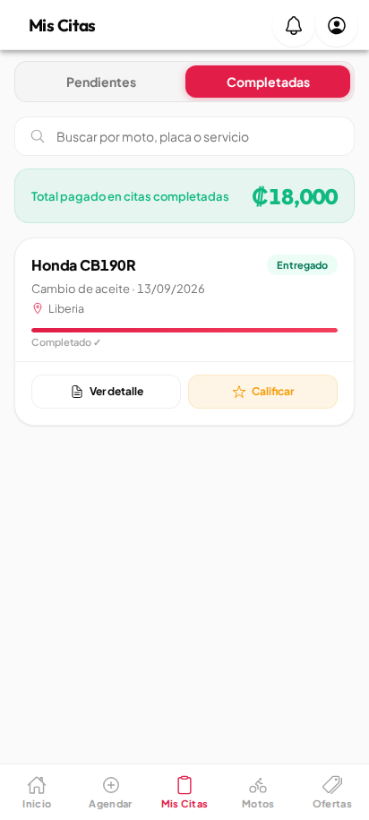 | 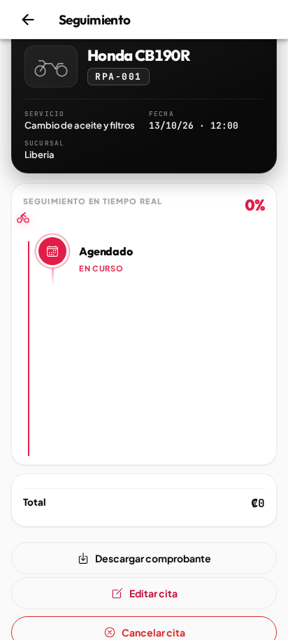 |

### 8.2 Qué registra

Después de cada recorrido el robot envía a Zabbix el resultado (1 o 0), la duración total, la duración de cada paso, el paso que falló y el mensaje de error.

| Instancia | Recorrido | Resultado | Duración | Por paso |
|---|---|---|---|---|
| Linux | Consulta | Correcto | 4,81 s | abrir 0,46 · login 2,39 · inicio 0,35 · motos 0,66 · citas 0,40 · logout 0,55 |
| Linux | Agendar | Correcto | 10,91 s | abrir 5,73 · login 0,93 · elegir 0,58 · reservar 0,97 · verificar 0,01 · cancelar 1,86 · logout 0,82 |
| Windows | Consulta | Correcto | 5,16 s | abrir 1,87 · login 1,49 · inicio 0,10 · motos 0,63 · citas 0,41 · logout 0,65 |
| Windows | Agendar | Correcto | 7,01 s | abrir 0,92 · login 1,84 · elegir 0,62 · reservar 0,97 · verificar 0,01 · cancelar 1,94 · logout 0,70 |

Son las primeras ejecuciones de cada instancia. Las alertas T12 (no pudo completar), T13 (lento) y T14 (dejó de reportar) existen para las dos.

### 8.3 Prueba de fallo

Se detuvo Nginx para ver qué reporta el robot cuando la aplicación no responde.

| Hora | Qué pasó |
|---|---|
| 11:39:04 | Se detiene Nginx en `vm-app` |
| 11:39:09 | El robot falla en el paso **abrir**. Zabbix abre T12 con "Paso: abrir" |
| 11:40:28 | n8n reinicia Nginx por su cuenta (T03) |
| 11:40:40 | El robot completa el recorrido en 4,68 s. Zabbix cierra T12 |

El robot guarda la captura de pantalla y el registro de cada fallo durante 7 días.

## 9. Evidencias técnicas

Todo está en el repositorio del equipo, **github.com/Proyect-integrador-2/Integrador2**. El Anexo A dice dónde está cada cosa.

| Tipo de evidencia | Qué hay |
|---|---|
| Configuraciones | Router, switch, Docker Compose, Nginx, respuestas de instalación de Windows |
| Scripts de despliegue | Uno por máquina virtual, más los del servidor. Con ellos se rehace la plataforma |
| Exportaciones | Los cinco tableros de Grafana y los dos flujos de n8n, en JSON |
| Capturas y fotos | 16 fotos de las pruebas de red, 5 tableros, Telegram, n8n, el robot y Windows |
| Actas de prueba | Un documento por área en `docs/evidencias/e3/`, con horas, resultados e incidencias |
| Gestión | Jira (proyecto IP2), Confluence y el historial de commits, donde cada cambio lleva su tarea |

## 10. Lo que pidió el profesor además de la guía

Estos puntos no están en la rúbrica del Entregable #3. Los pidió el profesor en sus observaciones a los entregables anteriores.

### 10.1 La aplicación también en Windows Server

MS Motos corre en `vm-app-win` instalada de forma nativa, sin contenedores: Node.js 22, MySQL 8.4 y la aplicación registrada como el servicio de Windows `MSMotos`, con una cuenta de servicio sin privilegios. La instala `infra/vm-app-win/desplegar.ps1`, que comprueba la huella o la firma digital de cada instalador antes de ejecutarlo.

| Tema | Linux (`vm-app`) | Windows (`vm-app-win`) |
|---|---|---|
| Ejecución | Docker Compose | Servicio de Windows y MySQL instalado |
| Publicación | Nginx en el puerto 80 | Node en el puerto 80 |
| Falla que se recupera sola | Contenedor o Nginx detenido | Servicio detenido |
| Monitoreo | Agente con plugin de Docker | Agente con el estado del servicio |
| Medición del robot | Los dos recorridos | Los mismos dos recorridos |

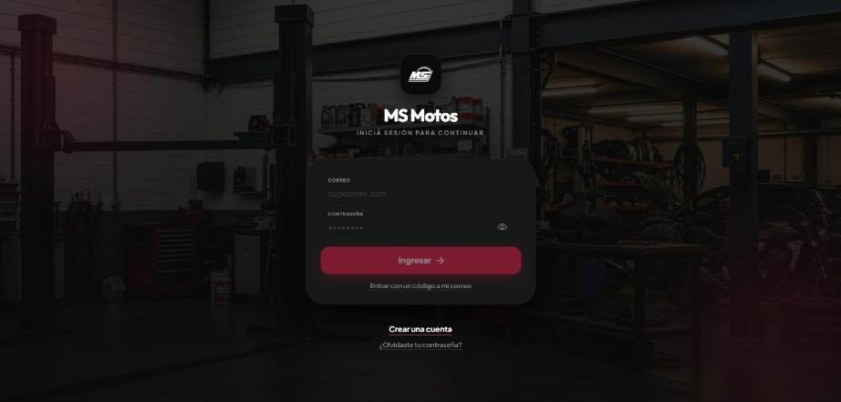

### 10.2 Active Directory

`vm-dc` es el controlador del dominio `ip2.local`, con su DNS. Tiene una cuenta por integrante, dos grupos (administradores y operadores) y una cuenta de servicio de solo lectura.

| Política del dominio | Valor |
|---|---|
| Longitud mínima de la contraseña | 12 caracteres, con complejidad |
| Vigencia e historial | 90 días; no repite las últimas 5 |
| Bloqueo | A los 5 intentos fallidos, durante 15 minutos |

**Prueba:** con una cuenta de prueba, una contraseña de 8 caracteres fue rechazada y la cuenta se bloqueó en el quinto intento fallido. Zabbix abrió las alertas T16 y T17 con el nombre de la cuenta y los avisos llegaron a Telegram.

`vm-app-win` ya está unida al dominio. La integración de Proxmox, Zabbix, Grafana y el SSH de las VM Linux con el dominio está pendiente.

### 10.3 Seguridad

| Capa | Control implementado |
|---|---|
| Red | Segmentación en VLAN, listas de acceso en el router, seguridad de puerto, DHCP snooping e inspección de ARP en el switch |
| Administración | Solo desde la VLAN 40 y, a distancia, por una red privada (Tailscale) |
| Máquinas virtuales | Sin contraseñas en Linux: solo llave SSH |
| Aplicación | Base de datos sin puerto publicado; contenedor sin root; secretos generados en cada VM |
| Automatización | Cuenta restringida, lista cerrada de acciones y máximo tres intentos |
| Identidad | Dominio con política de contraseñas, bloqueo y auditoría |
| Secretos | Ninguno en el repositorio ni en Confluence |

Verificar en los equipos reales cada control de endurecimiento del router y del switch (tarea IP2-88) y poner un cortafuegos en cada VM (IP2-89) están pendientes.

## 11. Criterios y pruebas de aceptación

| ID | Prueba | Resultado esperado | Evidencia | Estado |
|---|---|---|---|---|
| A-01 | Acceso usuario | Un cliente de la VLAN Usuarios puede consumir la aplicación | El usuario recibe dirección y sale a Internet (V1, V8), y la lista de acceso permite la aplicación. **Falta abrirla desde PC-CLIENTE** | **Pendiente** |
| A-02 | Acceso administrativo | La administración solo es accesible desde la red definida para ello | Sección 2.3: bloqueada desde Usuarios (V3 a V5). Sección 2.4: accesible desde Administración (V6, V7) | Cumple |
| A-03 | Internet | Los componentes que lo requieren salen por NAT/PAT | Sección 2.4: 122 traducciones en R1 (V9); ping a Internet desde las dos computadoras | Cumple |
| A-04 | Contenedor | La aplicación responde desde los contenedores | Sección 3.2 y la prueba de persistencia de la 3.3 | Cumple |
| A-05 | Monitoreo | Zabbix muestra estado y métricas de todas las capas obligatorias | Sección 4.1: servidor, VM, contenedores, servicios, aplicación, router, switch e interfaces | Cumple |
| A-06 | Dashboard | Grafana refleja datos reales y actuales | Sección 5: cinco capturas del 13 de octubre; 34 paneles con datos | Cumple |
| A-07 | Remediación | Al detener un servicio o contenedor, la automatización lo recupera | Sección 6.3: tres pruebas, recuperadas en 84, 65 y 75 segundos | Cumple |
| A-08 | Alerta | Al superar un umbral llega un aviso externo | Sección 7.3: CPU al 100 %, aviso en Telegram a los 5 minutos | Cumple |
| A-09 | RPA | El robot completa una transacción y registra tiempo y resultado | Sección 8: reserva y cancela una cita; envía duración y resultado a Zabbix | Cumple |

**Sobre A-01:** el día que se estuvo en el laboratorio la aplicación todavía no estaba desplegada, y la red de usuarios no llega al servidor por diseño, así que no se puede probar a distancia. Se prueba en la próxima visita, antes de la entrega.

## 12. Respuestas a las preguntas orientadoras

**¿Existe conectividad controlada entre todos los componentes?**
Sí. Cada red alcanza solo lo que le corresponde (sección 2.2) y se probó en los dos sentidos: lo permitido responde y lo prohibido lo rechaza el router. Dentro de la red de servidores, la base de datos no publica puerto, el router y el switch solo responden SNMP a Zabbix, y la cuenta de la automatización solo se acepta desde `vm-n8n`.

**¿Zabbix permite distinguir una falla de red de una falla de aplicación?**
Sí, porque cada capa tiene su propio chequeo. Una falla de red se ve en los hosts `r1` y `sw1` (interfaz caída, pérdida de ping). Una falla de aplicación se ve en el escenario web con la red en buen estado. Y dentro de la aplicación se distingue la causa: en la prueba de Nginx detenido el contenedor siguió reportándose en ejecución. Queda un detalle por afinar: cuando la causa es el contenedor o Nginx, la alerta general "aplicación no disponible" se abre unos segundos antes y no queda oculta.

**¿La automatización valida que el servicio realmente se recuperó?**
Sí, de dos formas. n8n revisa el código de salida del comando y lo anota. Y la confirmación la da Zabbix, que es independiente: el problema solo se cierra cuando su propio chequeo vuelve a ver el servicio arriba, y n8n anota ese "RESUELTO" con el tiempo transcurrido. Si la recuperación falla tres veces, deja de intentarlo y pide una persona.

**¿Los dashboards ayudan a decidir dónde está el problema?**
Sí. El tablero General dice si hay un problema y en qué componente. De ahí se pasa al tablero de la capa: Técnico para servidor, VM y contenedores; Red para el router y el switch; Experiencia para ver en qué paso se demora o falla un cliente; Automatización para ver qué se intentó ya.

**¿El RPA representa una operación real del sistema?**
Sí. El robot entra al portal con una cuenta de cliente, consulta su historial, reserva una cita, comprueba que quedó registrada en la base y la cancela. Usa un navegador real, no llamadas directas a la API.

## 13. Incidencias y diferencias con el diseño

### 13.1 Incidencias

| Qué pasó | Cómo se resolvió |
|---|---|
| Los avisos de Telegram no salían: n8n no lograba resolver nombres. Desde la red de la universidad el DNS 8.8.8.8 pierde entre el 10 % y el 40 % de las consultas | Las VM usan ahora los DNS de la universidad con 1.1.1.1 de respaldo, y los envíos se reintentan 5 veces |
| En la primera corrida del script del servidor se perdió la ruta por defecto y no se pudo descargar Tailscale | Se renovó el DHCP y el script ya lo hace solo |
| Grafana arrancó sin tableros: el repositorio se había clonado con permisos que el contenedor no podía leer | Se corrigieron los permisos y los scripts fijan la máscara |
| n8n no entregaba sus datos a Zabbix: los ítems solo aceptaban una dirección de origen que por la API no se ve | Se quitó esa lista; quien limita la escritura es el token de n8n |
| La recuperación en Windows fallaba con "Accion no permitida": n8n antepone `cd / ;` a cada comando | La lista cerrada quita ese prefijo y compara el resto |
| Durante un respaldo de prueba el robot dio un fallo falso por la carga de disco | Los respaldos programados tienen un tope de velocidad. Falta ver una corrida nocturna |
| El router y el switch rechazaban SSH desde el servidor | Se agregó el servidor a sus listas de acceso |

### 13.2 Diferencias con el diseño

| Diseño | Lo que se hizo | Por qué |
|---|---|---|
| Dejar los cables de consola conectados al servidor | No se dejaron | Faltaban puertos; antes de cada cambio riesgoso se programa un reinicio que deshace el cambio si se pierde el acceso |
| Windows instalado a mano | Instalación desatendida | El laboratorio se administra a distancia |
| n8n actúa sobre Windows por WinRM | Por SSH, con una cuenta restringida | Es el mismo mecanismo de Linux |
| n8n reporta a Zabbix con `zabbix_sender` | Por la API de Zabbix | El contenedor de n8n no trae ese programa |
| Respaldos en un disco externo | En un volumen propio del mismo servidor | No hay un disco externo conectado |
| Avisos por Telegram y correo | Solo Telegram | La guía pide uno de los dos |
| El dominio reenvía DNS a 8.8.8.8 | A los DNS de la universidad | 8.8.8.8 pierde consultas desde esta red |

## 14. Qué queda pendiente

| Qué | Para cuándo | Tarea |
|---|---|---|
| **A-01**: abrir la aplicación desde PC-CLIENTE, en sus dos instancias | Próxima visita, antes del 2 de noviembre | IP2-29 |
| Foto del rack con los equipos del grupo | Próxima visita | — |
| Capturas de Zabbix (*Últimos datos* por host) y de Active Directory | Antes del 2 de noviembre | IP2-42, IP2-79 |
| Verificar en los equipos cada control de endurecimiento | Entregable #4 | IP2-88 |
| Que la alerta general de la aplicación quede oculta cuando la causa ya está identificada | Entregable #4 | IP2-45 |
| Recuperación automática de interfaces de red | Entregable #4 | IP2-85, IP2-86 |
| Integrar Proxmox, Zabbix, Grafana y el SSH de Linux con el dominio | Entregable #4 | IP2-81 |
| Cortafuegos en cada VM y HTTPS en la aplicación | Entregable #4 | IP2-89, IP2-90 |
| Copia de los respaldos fuera del servidor | Entregable #4 | IP2-34 |
| Cambiar el DNS que el router entrega a los usuarios por DHCP | Próxima visita | IP2-28 |

## Anexo A · Dónde está cada evidencia

Repositorio del equipo: **github.com/Proyect-integrador-2/Integrador2**.

### A.1 Configuraciones y exportaciones

| Evidencia | Archivo |
|---|---|
| Configuración del router y del switch | `red/router/R1-4221.txt`, `red/switch/SW1-2960.txt` |
| Imagen y despliegue de la aplicación | `app/Dockerfile`, `app/docker-compose.yml`, `app/.env.example` |
| Tableros de Grafana (JSON) | `monitoreo/grafana/ip2-general.json`, `ip2-tecnico.json`, `ip2-red.json`, `ip2-experiencia.json`, `ip2-automatizacion.json` |
| Flujos de n8n (JSON) | `automatizacion/n8n/recuperacion-zabbix.json`, `estado-telegram.json` |
| Recorridos del robot | `rpa/recorridos/consulta.robot`, `agendar.robot`, `rpa/ejecutar.py` |
| Respuestas de instalación de Windows | `infra/proxmox/windows/autounattend.xml`, `primer-arranque.ps1` |

### A.2 Scripts de despliegue

| Qué despliega | Archivo |
|---|---|
| Servidor: red, acceso remoto, VM, respaldos y token de monitoreo | `infra/acceso-remoto/preparar-proxmox.sh`, `infra/proxmox/crear-vms.sh`, `crear-vms-windows.sh`, `respaldos.sh`, `token-zabbix.sh` |
| Aplicación en Linux y su cuenta de automatización | `infra/vm-app/desplegar.sh`, `preparar-n8n-ops.sh` |
| Zabbix, sus agentes y toda su configuración | `infra/vm-zabbix/desplegar.sh`, `instalar-agente.sh`, `instalar-agente-windows.ps1`, `configurar-zabbix.py` |
| Grafana | `infra/vm-grafana/desplegar.sh`, `verificar-tableros.py` |
| n8n y Telegram | `infra/vm-n8n/desplegar.sh`, `configurar-telegram.sh` |
| Robot | `infra/vm-rpa/desplegar.sh` |
| Aplicación en Windows, su cuenta de automatización y la unión al dominio | `infra/vm-app-win/desplegar.ps1`, `preparar-n8n-ops.ps1`, `unir-dominio.ps1` |
| Dominio | `infra/vm-dc/promover-dominio.ps1`, `configurar-dominio.ps1`, `probar-bloqueo.ps1` |

### A.3 Actas de prueba y capturas

| Área | Documento | Imágenes |
|---|---|---|
| Red, servidor, VM Linux, aplicación, Zabbix, Grafana y n8n | `docs/evidencias/e3/2026-10-12-visita-laboratorio.md` | `docs/evidencias/e3/red/` (16 fotos), `automatizacion/` |
| Alertas por Telegram | `docs/evidencias/e3/alertas.md` | `docs/evidencias/e3/alertas/` |
| Robot | `docs/evidencias/e3/rpa.md` | `docs/evidencias/e3/rpa/` |
| Windows Server y Active Directory | `docs/evidencias/e3/windows.md` | `docs/evidencias/e3/windows/` |
| Respaldos | `docs/evidencias/e3/respaldos.md` | `docs/evidencias/e3/respaldos/` |
| Tableros de Grafana | — | `docs/evidencias/e3/grafana/` |

### A.4 Gestión del proyecto

| Herramienta | Uso |
|---|---|
| Jira, proyecto IP2 | Tablero y cronograma. Cada tarea tiene su criterio de terminado y, al avanzar, un comentario con lo hecho y la evidencia |
| Confluence | Inventario, minutas semanales y los documentos de entrega |
| GitHub | Código, configuraciones y evidencias. Cada commit empieza con la tarea de Jira a la que pertenece |
