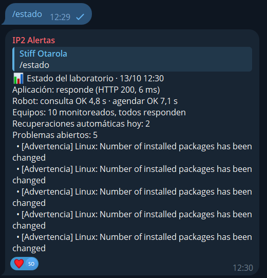

# Alertas a una persona por Telegram

Tareas: IP2-51 (notificaciones), IP2-54 (alertas de capacidad) y parte de IP2-45 (triggers). Hecho y probado el 13 de octubre de 2026, a distancia.

## 1. Cómo funciona

Zabbix avisa a n8n de cada problema del grupo *Integrador II*. El flujo [`recuperacion-zabbix.json`](../../../automatizacion/n8n/recuperacion-zabbix.json) decide si corresponde una acción automática y, además, arma un mensaje y lo envía al grupo de Telegram **IP2 Alertas**, donde están los integrantes del equipo.

| Se avisa | No se avisa |
|---|---|
| Los triggers del proyecto (T01, T03, T04, T06…) con cualquier severidad | Avisos de plantilla de severidad baja, como "cambió el número de paquetes instalados" |
| Todo problema de severidad media, alta o desastre | Eventos que no traen el token de Zabbix |
| El cierre de cada uno ("RESUELTO") | |

Cada mensaje trae el estado, la severidad, el trigger, el host, la hora, el valor medido, la acción automática con su resultado si la hubo, y el número de evento de Zabbix.

El bot se conecta con [`configurar-telegram.sh`](../../../infra/vm-n8n/configurar-telegram.sh), que pide el token sin mostrarlo y lo guarda solo en el `.env` de `vm-n8n`. No está en el repositorio.

## 2. Umbrales de capacidad

En las cinco VM. Solo alertan: nadie amplía recursos en automático.

| Trigger | Advertencia | Alta |
|---|---|---|
| T06 CPU alta | > 85 %, promedio de 5 min | > 95 %, promedio de 5 min |
| T07 Memoria alta | > 85 %, promedio de 5 min | > 95 %, promedio de 5 min |
| T08 Disco `/` lleno | > 80 % | > 90 % |

Para la red se usan los triggers de la plantilla *Cisco IOS by SNMP* (enlace caído, errores, uso alto de ancho de banda), que llegan por el mismo camino.

## 3. Prueba A-08: superar un umbral y recibir el aviso

Se puso la CPU de `vm-grafana` al 100 % durante 8 minutos (`yes > /dev/null`).

| Hora | Qué pasó |
|---|---|
| 14:36:14 | Empieza la carga |
| 14:41:30 | Zabbix abre "T06 CPU alta en vm-grafana (> 85 %)". n8n envía el aviso a Telegram |
| 14:42:30 | Zabbix abre "T06 CPU alta en vm-grafana (> 95 %)". n8n envía el aviso a Telegram |
| 14:44:14 | Termina la carga |
| Minutos después | Zabbix cierra los dos problemas y n8n envía los "RESUELTO" |

El aviso llegó 5 minutos y 16 segundos después de empezar la carga: es la ventana de 5 minutos del umbral más la lectura siguiente. En la base de n8n los dos envíos quedaron con respuesta correcta de Telegram.

## 4. Incidencia: avisos que no salían

Las dos primeras corridas de esta prueba (12:13 y 14:25) dispararon la alerta en Zabbix y n8n la procesó, pero **el aviso de "PROBLEMA" no llegó a Telegram**. El envío fallaba con `getaddrinfo EAI_AGAIN api.telegram.org`: n8n no lograba resolver el nombre.

| Qué se midió, desde `vm-n8n` | Resultado |
|---|---|
| 60 consultas DNS a 8.8.8.8, el servidor que tenían las VM | 6 a 8 sin respuesta de cada 20 en la primera medición; 6 de 60 en la segunda |
| 60 consultas a los DNS de la universidad (10.100.8.2 y 10.100.8.3) | 1 y 0 sin respuesta |
| 60 consultas a 1.1.1.1 | 0 sin respuesta |
| Desde el contenedor de n8n, antes del arreglo | Ninguna falló, pero una tardó 13 segundos |

La red del laboratorio pierde de vez en cuando una consulta DNS, sobre todo hacia 8.8.8.8, y cada pérdida dejaba al contenedor esperando varios segundos.

**Arreglo** ([`dns-vm.sh`](../../../infra/proxmox/dns-vm.sh), aplicado en las cinco VM):

- Las VM usan los DNS de la universidad, con 1.1.1.1 de respaldo.
- Los contenedores preguntan al resolvedor de su VM, que guarda las respuestas y reintenta con los tres servidores.
- Los envíos a Telegram se reintentan hasta 5 veces, con 5 segundos entre intentos.

Después del arreglo salieron todos los avisos de la tercera corrida. Sigue pendiente cambiar el DNS que R1 entrega por DHCP a los usuarios, que todavía es 8.8.8.8.

## 5. Consulta del estado desde Telegram

El flujo [`estado-telegram.json`](../../../automatizacion/n8n/estado-telegram.json) revisa cada 10 segundos si alguien del grupo de alertas escribió `/estado`. Si es así, pide a Zabbix el estado de la aplicación, del robot, de los equipos y de los problemas abiertos, y responde en el grupo. Solo atiende a ese grupo.

## 6. Pendiente

| Qué | Tarea |
|---|---|
| Captura del grupo con los avisos de la prueba A-08 | IP2-51 |
| Correo como segundo canal (la rúbrica pide Telegram o correo) | IP2-51 |
| Cambiar en R1 el DNS que reciben los usuarios por DHCP | IP2-28 |
