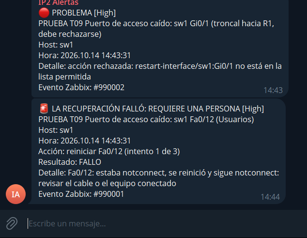

# Recuperación automática de la red

Tareas: IP2-85 (cuenta de automatización en el switch), IP2-86 (flujo de n8n) e IP2-87 (prueba en el equipo). Construido y probado a distancia el 14 de octubre de 2026; la prueba con un equipo conectado al switch queda para la próxima visita al laboratorio (sección 6).

Responde al criterio CA-14 y a la prueba PR-12: ante un evento de red, la automatización reinicia el puerto afectado; si el evento es en un enlace de gestión, solo alerta.

## 1. Cómo funciona

```
Zabbix: puerto de acceso caído (T09, remediation=restart-interface, target=sw1:Fa0/7)
   │
   ▼
n8n · ¿el puerto está en la lista blanca (Fa0/1 a Fa0/20)? ── no ──► solo alerta
   │ sí
   ▼
¿menos de 3 intentos en 10 minutos? ── no ──► escala a una persona
   │ sí
   ▼
n8n --SSH, cuenta n8n-red--> vm-n8n: red-accion.py --SSH, cuenta n8n-net--> SW1
        shutdown · 5 segundos · no shutdown · espera hasta 30 s a que el puerto vuelva
   │
   ├── quedó conectado ──► Telegram "RECUPERACIÓN AUTOMÁTICA" · Zabbix cierra T09
   └── sigue caído    ──► Telegram "LA RECUPERACIÓN FALLÓ: REQUIERE UNA PERSONA"
```

n8n no entra directo al switch: el 2960 solo ofrece algoritmos de SSH antiguos (Diffie-Hellman con SHA-1 y AES-CBC) que el nodo SSH de n8n no soporta. Por eso entra a su propia VM con la cuenta `n8n-red`, y ahí [`red-accion.py`](../../../infra/vm-n8n/red-accion.py) habla con el switch usando paramiko, que sí admite esos algoritmos.

## 2. Qué detecta Zabbix

| Trigger | Dónde | Condición | Severidad | Acción |
|---|---|---|---|---|
| T09 Puerto de acceso caído | Cada puerto de acceso de SW1, Fa0/1 a Fa0/20 | Caído durante 2 minutos, habiendo estado conectado en los últimos 15. Se cierra cuando el puerto vuelve | Alta | n8n reinicia el puerto |
| T09-G Enlace de gestión caído | SW1 Gi0/1 (troncal a R1) y Gi0/2 (troncal al servidor); R1 Gi0/0/0 (WAN) y Gi0/0/1 (troncal a SW1) | Caído durante 1 minuto | Desastre | **Solo alerta** |

"Haber estado conectado en los últimos 15 minutos" evita actuar sobre los puertos que no tienen nada enchufado: sin esa condición, n8n reiniciaría cada cierto tiempo todos los puertos vacíos. Un puerto bloqueado (*err-disabled*) también aparece como caído, así que T09 cubre los dos casos.

Para estos puertos se apagó el aviso "Link down" de la plantilla, que T09 y T09-G reemplazan, y así no llegan dos avisos por el mismo evento.

## 3. Controles

| Control | Cómo se cumple | Cómo se probó |
|---|---|---|
| Lista blanca de puertos (C8) | Dos veces: en n8n y en `red-accion.py`. Solo Fa0/1 a Fa0/20 | Avisos de prueba sobre Gi0/1 y Fa0/21: rechazados, el switch no se tocó |
| Mínimo privilegio en el switch | `n8n-net` tiene nivel 5: entrar a una interfaz, `shutdown`, `no shutdown` y ver interfaces | Con esa cuenta, `show running-config` y `show startup-config` responden "Invalid input" |
| Lista cerrada en la VM | La llave de `n8n-red` solo ejecuta `red-accion.py`, que acepta `estado` y `reiniciar` | `show running-config` y `reiniciar Gi0/1` responden "Accion no permitida" |
| Origen | La llave de `n8n-red` solo sirve desde los contenedores de `vm-n8n`, y el switch solo acepta SSH de `vm-n8n`, de Administración y del servidor | La misma llave desde la propia VM, fuera de ese rango: "Permission denied" |
| No deshacer lo que hizo una persona | Si el puerto está apagado a propósito (`shutdown`, estado `disabled`), no se toca | Por código; se prueba en el laboratorio |
| Tres intentos en 10 minutos | El mismo contador de las demás recuperaciones | — |
| Secretos | La contraseña de `n8n-net` se generó en `vm-n8n`, en un archivo que solo lee `n8n-red`. No está en el repositorio | — |

La primera vez que se imprimió el bloque de configuración del switch, su contraseña quedó copiada en un chat. Se descartó y se generó otra antes de configurarla en el switch.

## 4. Pruebas a distancia (14 de octubre)

| Prueba | Resultado |
|---|---|
| `estado Fa0/12` y `estado Fa0/1` | `notconnect` (nada conectado) |
| `reiniciar Fa0/12` | El switch aceptó `shutdown` y `no shutdown`; el puerto quedó habilitado y, sin nada conectado, sigue `notconnect`. Respuesta: "revisar el cable o el equipo conectado". 39 segundos |
| Aviso de prueba de Zabbix sobre Fa0/12 | n8n reinició el puerto, avisó "LA RECUPERACIÓN FALLÓ: REQUIERE UNA PERSONA" con el detalle, y reportó a Zabbix: resultado 0, 40,6 s, "reiniciar Fa0/12 (falló, intento 1 de 3)" |
| Aviso de prueba sobre Gi0/1, el troncal hacia R1 | Rechazado: "no está en la lista permitida". Contado en "acciones rechazadas" |



Los avisos de prueba llevan "PRUEBA" en el nombre y números de evento que no existen en Zabbix.

## 5. Qué cambió respecto al diseño

| Diseño | Lo que se hizo | Por qué |
|---|---|---|
| n8n entra por SSH al router y al switch | Entra a `vm-n8n` y desde ahí un programa habla con el switch | El nodo SSH de n8n no soporta los algoritmos del 2960 |
| Cuenta de automatización también en el router | Solo en el switch | El router no tiene puertos de acceso: sus interfaces son la WAN y el troncal, que nunca se reinician solas |
| Puerto *err-disabled* (T09b): reactivación inmediata | Lo cubre T09, a los 2 minutos | Un puerto bloqueado aparece como caído; el mismo reinicio lo reactiva |
| Equipo saturado (T11): respaldo y `reload` del equipo | No implementado | Reiniciar el switch o el router corta toda la red del laboratorio; queda pendiente de decidir si se hace |
| Ensayo previo en Packet Tracer (C10) | Se probó contra el equipo real, sobre un puerto sin nada conectado | El equipo real ya está disponible y la prueba no afecta a nadie |

En el switch, la seguridad de puerto está en modo `restrict`: una violación descarta el tráfico pero **no** bloquea el puerto. Un puerto sí puede quedar *err-disabled* por exceso de solicitudes DHCP (límite de 15 por segundo en la VLAN de usuarios), por exceso de ARP o por conectarse y desconectarse muchas veces seguidas.

## 6. Prueba pendiente en el laboratorio (PR-12, IP2-87)

Necesita un equipo conectado al switch. Con PC-CLIENTE en Fa0/5:

| Paso | Qué hacer | Resultado esperado |
|---|---|---|
| 0 | Conectar PC-CLIENTE a Fa0/5 y esperar 2 minutos | En Zabbix, Fa0/5 aparece como `up` |
| 1 | **Cable desconectado:** desconectarlo y esperar 3 minutos | T09 se abre; n8n reinicia Fa0/5; llega "LA RECUPERACIÓN FALLÓ… revisar el cable" |
| 2 | Volver a conectar el cable | Fa0/5 vuelve; Zabbix cierra T09 y llega "RESUELTO" |
| 3 | **Puerto bloqueado:** en SW1 revisar `show errdisable detect` (que esté activo `link-flap`); desconectar y conectar el cable 6 veces en menos de 10 segundos | El puerto queda `err-disabled` con el cable puesto |
| 4 | Esperar 3 minutos | T09 se abre; n8n reinicia Fa0/5; el puerto vuelve; llega "RECUPERACIÓN AUTOMÁTICA… quedó conectado" y Zabbix cierra T09 |
| 5 | **Puerto apagado por una persona:** `shutdown` en Fa0/5 desde la cuenta admin y esperar 3 minutos | n8n no lo enciende: "apagado a propósito (shutdown): no se toca" |

Los enlaces de gestión no se prueban desconectándolos, porque cortarían el laboratorio. Su comportamiento quedó probado con el aviso sobre Gi0/1 de la sección 4.
