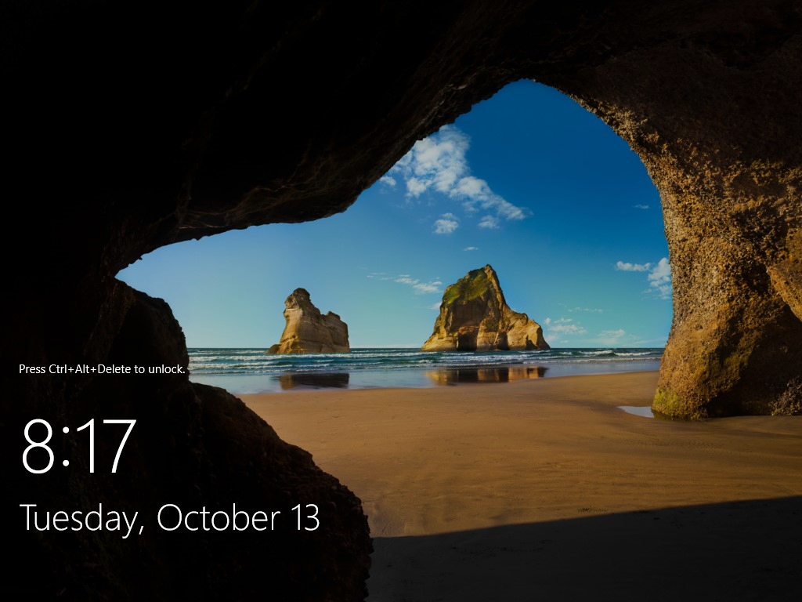

# Respaldos de las máquinas virtuales

Tarea: IP2-34, y la parte de respaldo del riesgo R-14 (IP2-79). Hecho y probado el 13 de octubre de 2026, a distancia.

## 1. Dónde se guardan

[`respaldos.sh`](../../../infra/proxmox/respaldos.sh) crea en el servidor un volumen aparte de 300 GB, montado en `/mnt/respaldos`, y lo registra en Proxmox como el almacenamiento `respaldos`. Va aparte para que las copias, si crecen, no llenen el disco del sistema.

| Almacenamiento | Tipo | Para qué | Tamaño |
|---|---|---|---|
| `local` | Carpeta en el disco del sistema | Instaladores e imágenes | 94 GB |
| `local-lvm` | Volúmenes delgados | Discos de las VM | 2 TB |
| `respaldos` | Carpeta en un volumen propio | Copias de las VM | 295 GB |

## 2. Qué se respalda y cuándo

Son los tres trabajos del diseño, programados en Proxmox:

| Trabajo | VM | Cuándo | Copias que se conservan |
|---|---|---|---|
| `ip2-diario-criticas` | `vm-app`, `vm-zabbix`, `vm-dc` | Todos los días a las 02:00 | 3 |
| `ip2-diario-windows` | `vm-app-win` | Todos los días a las 02:40 | 2 |
| `ip2-semanal` | `vm-grafana`, `vm-n8n`, `vm-rpa` | Domingos a las 03:20 | 2 |

Los respaldos se hacen con la VM encendida (modo *snapshot*) y comprimidos con zstd. Las configuraciones (tableros, flujos, scripts) no dependen de estos respaldos: están en GitHub.

## 3. Prueba: respaldar y restaurar el controlador de dominio

| Paso | Resultado |
|---|---|
| Respaldo de `vm-dc` (disco de 60 GB) | 1 minuto 55 segundos; archivo de 5,16 GB |
| Restauración en una VM aparte (ID 917), con la tarjeta de red desconectada | 69 segundos |
| Arranque de la VM restaurada | Windows Server llegó a la pantalla de inicio de sesión |
| Limpieza | La VM 917 se borró al terminar |

La copia se arrancó **sin red** a propósito: dos controladores del mismo dominio encendidos a la vez en la misma red se estorban.

## 4. Incidencia: el respaldo hizo lento al resto

Durante el respaldo y la restauración de prueba (20:11 a 20:16), el servidor leyó y escribió disco a más de 500 MiB/s. En esos minutos un recorrido del robot que tarda unos 5 s tardó 9,9 s, y otro dio un fallo falso al cerrar el navegador, que abrió la alerta T12. El recorrido siguiente salió bien.

Por eso los tres trabajos programados quedaron con un tope de lectura de 150 MiB/s. El tope está puesto, pero **todavía no se ha visto correr un respaldo nocturno con él**: hay que revisar el 14 de octubre si a las 02:00 hubo alertas del robot.

## 5. Límite conocido

| Diseño | Lo que se hizo | Por qué |
|---|---|---|
| Destino en disco externo USB o almacenamiento alterno | Volumen propio en los mismos discos del servidor | El servidor solo tiene su arreglo de discos interno; no hay un disco externo conectado |

Esto protege de borrar o dañar una VM, no de perder el servidor entero. Para eso hace falta copiar `/mnt/respaldos` a un equipo fuera del servidor.

## 6. Pendiente

| Qué | Tarea |
|---|---|
| Revisar que los respaldos de las 02:00 se hagan y no disparen alertas | IP2-34 |
| Copia fuera del servidor | IP2-34 |
| Cuenta local de emergencia comprobada en cada herramienta (riesgo R-14) | IP2-79 |
