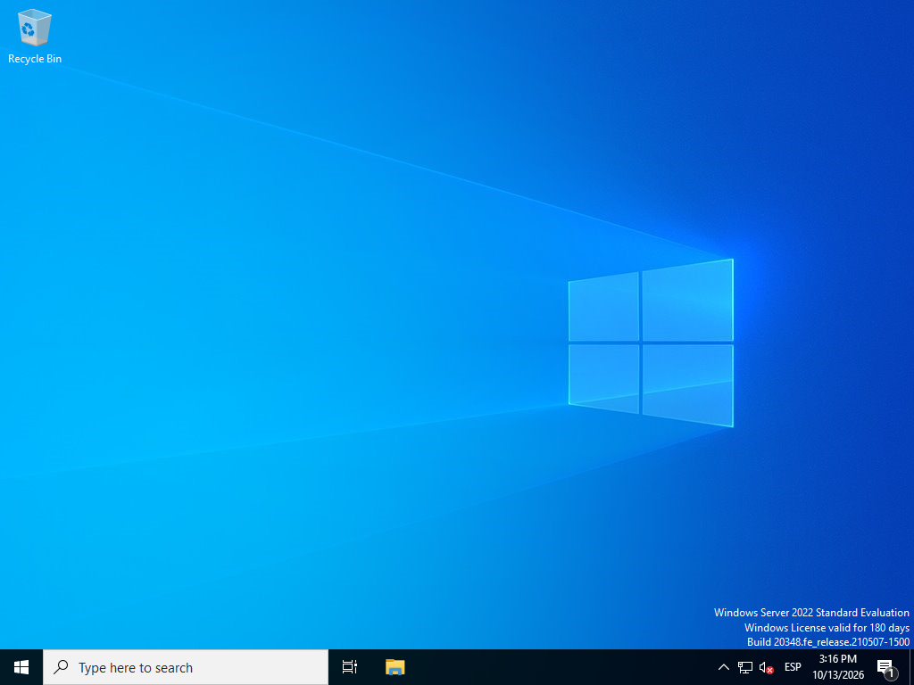
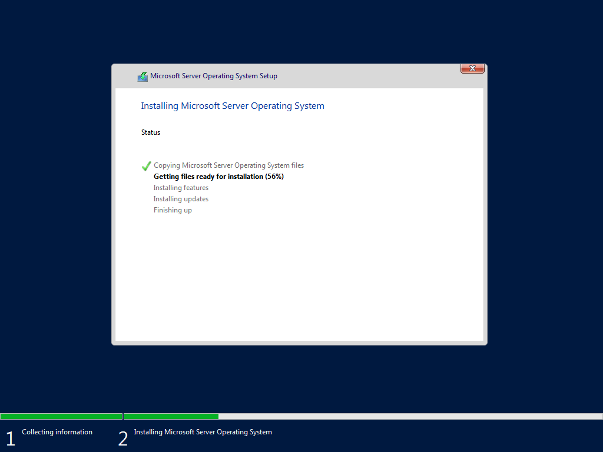
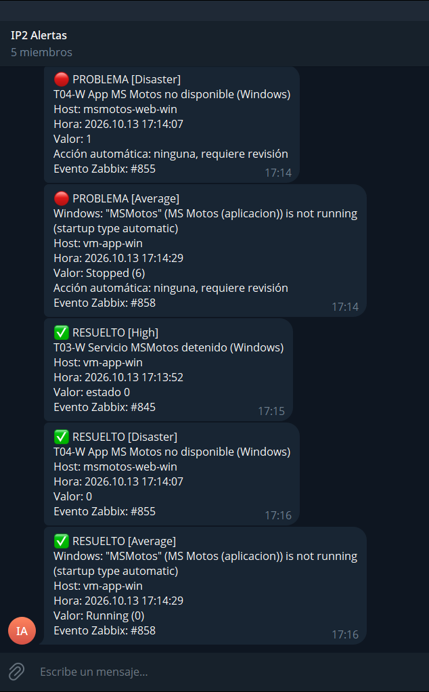
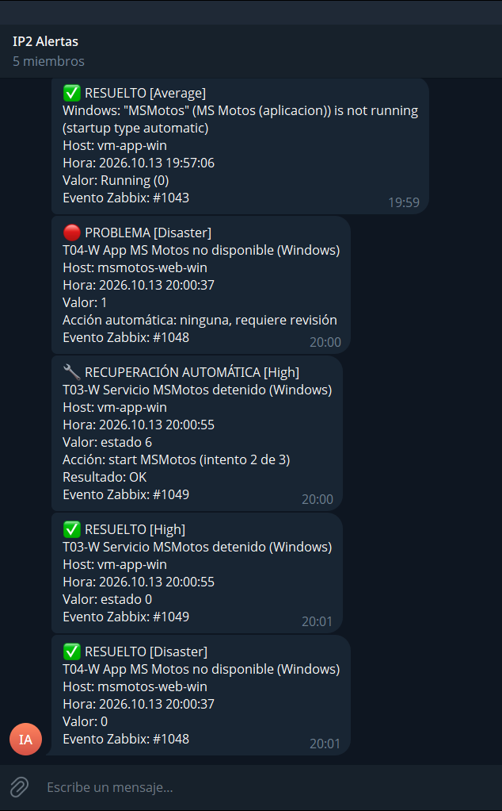

# Windows Server y Active Directory

Tareas: IP2-73 (VM Windows de la aplicación), IP2-74 (MS Motos en Windows), IP2-75 (su monitoreo), IP2-79 (controlador de dominio), IP2-80 (política de contraseñas), IP2-81 (unión al dominio), IP2-82 (seguridad del dominio) y parte de IP2-42 (monitoreo del servidor). Hecho y probado el 13 de octubre de 2026, a distancia.

Estas dos VM no están en la rúbrica del E3: las pidió el profesor en sus observaciones al E1 (aplicación también en Windows Server, y Active Directory para validar usuarios).

## 1. Las dos máquinas virtuales

| VM | ID | Nombre en Windows | IP | Recursos | Papel |
|---|---|---|---|---|---|
| `vm-app-win` | 116 | `VM-APP-WIN` | 10.10.30.16 | 2 vCPU · 4 GB · 60 GB | Segundo ambiente de MS Motos, como servicio de Windows |
| `vm-dc` | 117 | `DC01` | 10.10.30.17 | 2 vCPU · 4 GB · 60 GB | Controlador del dominio `ip2.local` y su DNS |

Las dos corren **Windows Server 2022 Standard, evaluación de 180 días** (con escritorio), en la VLAN 30, y arrancan solas con el servidor.



## 2. Cómo se instalaron

Nadie tocó la consola. [`crear-vms-windows.sh`](../../../infra/proxmox/crear-vms-windows.sh) crea cada VM con dos CD: el instalador de Microsoft y un CD de respuestas que arma el propio script.

| Paso | Quién lo hace |
|---|---|
| Particionar el disco, elegir la edición, aceptar la licencia de evaluación | [`autounattend.xml`](../../../infra/proxmox/windows/autounattend.xml) |
| Nombre del equipo, zona horaria de Costa Rica, contraseña de `Administrator` | `autounattend.xml` |
| IP fija, DNS, ping, escritorio remoto y servidor SSH con llave | [`primer-arranque.ps1`](../../../infra/proxmox/windows/primer-arranque.ps1) |
| Expulsar los CD y borrar el de respuestas, que lleva la contraseña | `crear-vms-windows.sh`, cuando la VM responde por SSH |



| Dato | Resultado |
|---|---|
| Instalador | `SERVER_EVAL_x64FRE_en-us.iso`, 5 044 094 976 bytes, del Centro de Evaluación de Microsoft |
| SHA-256 del instalador | `3e4fa6d8507b554856fc9ca6079cc402df11a8b79344871669f0251535255325` |
| Tiempo de `vm-app-win`, de crearla a responder por SSH | 14 minutos |
| Tiempo de `vm-dc` | 13 minutos |
| Estado de la licencia (`slmgr /dli`) | `ServerStandardEval`, licenciada |

## 3. Acceso remoto

| Medio | Cómo | Desde dónde |
|---|---|---|
| SSH | `ssh Administrator@10.10.30.16` (o `.17`). Solo con llave; abre PowerShell | VLAN 30 y VLAN 40 |
| Escritorio remoto | `mstsc /v:10.10.30.16`, usuario `Administrator` | VLAN 30 y VLAN 40 |

La contraseña de `Administrator` se generó en el servidor Proxmox y está solo ahí, en `/root/secretos-ip2/windows-administrator.txt`. No está en el repositorio ni en Confluence.

Comprobación por SSH, desde la laptop de administración por Tailscale:

```
VM-APP-WIN
Microsoft Windows Server 2022 Standard Evaluation
10.10.30.16 gw 10.10.30.1 dns 10.100.8.2,10.100.8.3,1.1.1.1
sshd        Running Automatic
Central America Standard Time
```

## 4. El dominio `ip2.local`

`vm-dc` se promovió con [`promover-dominio.ps1`](../../../infra/vm-dc/promover-dominio.ps1) (roles AD DS y DNS, bosque nuevo) y se dejó como en el diseño con [`configurar-dominio.ps1`](../../../infra/vm-dc/configurar-dominio.ps1).

| Dato | Valor |
|---|---|
| Dominio / NetBIOS | `ip2.local` / `IP2` |
| Controlador | `DC01.ip2.local` (10.10.30.17) |
| Nivel funcional | Windows Server 2016 |
| DNS | Resuelve el dominio y reenvía el resto a 10.100.8.2, 10.100.8.3 y 1.1.1.1 |

```
ip2.local
└── OU=IP2
    ├── GG-IP2-Administradores   stiff.aleman, alexander.jimenez, angel.gallardo
    ├── GG-IP2-Operadores        jeffrey.herrera, alvaro.alvarez
    ├── OU=Usuarios              las cinco cuentas personales
    ├── OU=Servicios             svc-ldap (solo lectura del directorio)
    └── OU=Equipos               para las máquinas que se unan al dominio
```

Cada cuenta personal nació con una contraseña temporal aleatoria marcada para cambiarse en el primer inicio de sesión. Esa marca resultó incompatible con la validación por LDAP de las herramientas (ver [dominio.md](dominio.md), sección 4), así que el 14 de octubre se quitó: cada integrante tiene una contraseña aleatoria de 16 caracteres que puso [`nueva-clave.ps1`](../../../infra/vm-dc/nueva-clave.ps1) o que eligió por su cuenta.

## 5. Política de contraseñas y bloqueo (RNF-09)

Aplicada en la GPO *Default Domain Policy*. Lo que reporta el dominio (`net accounts /domain`):

| Regla | Valor |
|---|---|
| Longitud mínima | 12 caracteres |
| Complejidad | Activada |
| Vigencia máxima | 90 días |
| Historial | 5 contraseñas |
| Bloqueo | A los 5 intentos fallidos, durante 15 minutos |
| Auditoría | Inicios de sesión correctos y fallidos, bloqueos y cambios de cuentas |

**Prueba** con [`probar-bloqueo.ps1`](../../../infra/vm-dc/probar-bloqueo.ps1), que crea una cuenta de prueba, falla a propósito y la borra:

```
Contrasena de 8 caracteres: rechazada por la politica
Intento 1 con contrasena incorrecta: entro=False  cuenta bloqueada=False
Intento 2 con contrasena incorrecta: entro=False  cuenta bloqueada=False
Intento 3 con contrasena incorrecta: entro=False  cuenta bloqueada=False
Intento 4 con contrasena incorrecta: entro=False  cuenta bloqueada=False
Intento 5 con contrasena incorrecta: entro=False  cuenta bloqueada=True
Intento 6 con contrasena incorrecta: entro=False  cuenta bloqueada=True
Con la contrasena correcta, estando bloqueada: entro=False
Eventos 4740 de la cuenta: 1
Eventos 4625 de la cuenta: 7
```

La cuenta se bloqueó en el quinto intento y quedaron los eventos de seguridad que después leerá Zabbix (4625 inicio fallido, 4740 cuenta bloqueada).

## 6. El servidor físico en Zabbix

De paso se completó el monitoreo del servidor (prueba A-05), que hasta ahora era solo por ping. Zabbix lee la API de Proxmox con un token de **solo lectura** (rol `PVEAuditor`) que crea [`token-zabbix.sh`](../../../infra/proxmox/token-zabbix.sh).

| Qué se ve ahora del servidor | Ejemplo del 13 de octubre |
|---|---|
| Nodo: CPU, carga, memoria, disco raíz, tiempo encendido, versión | CPU 3,7 % · memoria 27,9 de 66,7 GB |
| Cada VM: estado, CPU, memoria, disco y red | Las siete en `running` |
| Almacenamiento | `local` y `local-lvm` |

105 ítems, ninguno con error. La alerta de "memoria alta por VM" de la plantilla se silenció: desde el hipervisor la memoria de una VM siempre parece llena, y la memoria real ya la vigila T07 con el agente de cada VM.

## 7. MS Motos en Windows

Instalación nativa, sin contenedores, con [`desplegar.ps1`](../../../infra/vm-app-win/desplegar.ps1). Cada instalador se comprueba antes de ejecutarse (huella publicada o firma digital del fabricante).

| Componente | Versión | Cómo queda |
|---|---|---|
| Node.js | 22.23.3 | Ejecuta el backend y sirve el frontend compilado en la propia VM |
| MySQL | 8.4.9 | Servicio `MySQL84`; solo escucha en `127.0.0.1` |
| NSSM | 2.24 | Registra la aplicación como servicio |
| Servicio `MSMotos` | — | Inicio automático, cuenta `LocalService`, puerto 80, depende de `MySQL84` |

Las variables están en `C:\opt\msmotos\.env`, con secretos propios de esta instancia que solo leen los administradores y la cuenta del servicio. Las tareas programadas quedan apagadas aquí (`DISABLE_CRON=1`) para no duplicar las de Linux. El script creó las cuentas iniciales y el cliente sintético del RPA con su moto y su servicio de prueba.

Comprobación desde `vm-rpa`: `/api/health` responde 200 en 5 ms y el portal carga.


## 8. Monitoreo de las VM Windows

Las dos VM tienen el agente 2 de Zabbix 7.0.31 ([`instalar-agente-windows.ps1`](../../../infra/vm-zabbix/instalar-agente-windows.ps1)) con la plantilla *Windows by Zabbix agent*: CPU, memoria, discos, red y servicios. Solo el servidor de Zabbix puede consultar al agente.

| Qué | Cómo | Trigger |
|---|---|---|
| Servicio `MSMotos` | Ítem de estado cada 30 s en `vm-app-win` | **T03-W**: detenido durante 1 minuto → High |
| Aplicación | Escenario web contra `http://10.10.30.16` (host `msmotos-web-win`) | **T04-W** no disponible → Disaster · **T05-W** lenta |

**Prueba** del 13 de octubre: se detuvo el servicio a las 17:13:15.

| Hora | Qué pasó |
|---|---|
| 17:13:15 | `Stop-Service MSMotos` |
| 17:13:52 | Zabbix abre T03-W (37 s después) y llega el aviso a Telegram |
| 17:14:07 | Zabbix abre T04-W: la aplicación de Windows no responde |
| 17:15:55 | Se inicia el servicio a mano; `/api/health` vuelve a 200 |
| 17:16 | Llegan los "RESUELTO" |



### Recuperación automática

Después se agregó la recuperación: cuando T03-W se abre, n8n entra por SSH a `vm-app-win` e inicia el servicio, igual que hace con Nginx y con el contenedor en Linux.

| Control | Cómo queda en Windows ([`preparar-n8n-ops.ps1`](../../../infra/vm-app-win/preparar-n8n-ops.ps1)) |
|---|---|
| Lista cerrada (C1) | La cuenta `n8n-ops` no es administradora. `sshd` ata su sesión a un script que solo acepta dos pedidos: iniciar `MSMotos` y consultar su estado. Cualquier otro comando responde "Accion no permitida" |
| Mínimo privilegio (C4) | Sobre el servicio tiene permiso de iniciar y consultar, no de detener ni de cambiar su configuración. Entra solo con llave |
| Tres intentos (C2, C3) | El mismo contador del flujo: tres intentos en diez minutos y después escala a una persona |

**Prueba** del 13 de octubre a las 19:59:

| Hora | Qué pasó |
|---|---|
| 19:59:46 | `Stop-Service MSMotos` |
| 20:00:55 | Zabbix abre T03-W y avisa a n8n |
| 20:01:01 | El servicio vuelve a estar en ejecución: 75 segundos después de detenerlo, sin intervención |
| 20:01 | Llegan los "RESUELTO"; `/api/health` responde 200 |

n8n reportó a Zabbix la ejecución: resultado correcto, 5,2 s de duración y 30 s de la detección al cierre.



Las dos primeras corridas de esta prueba fallaron con "Accion no permitida": el nodo SSH de n8n antepone `cd / ;` a cada comando y la lista cerrada de Windows lo rechazaba. Se corrigió para que quite ese prefijo y compare el resto.

## 9. `vm-app-win` unida al dominio

[`unir-dominio.ps1`](../../../infra/vm-app-win/unir-dominio.ps1) unió la VM a `ip2.local` y la dejó en la unidad `OU=Equipos,OU=IP2`. La contraseña del administrador del dominio pasó del servidor Proxmox a la VM sin escribirse en ningún comando.

| Comprobación | Resultado |
|---|---|
| Equipo en el directorio | `CN=VM-APP-WIN,OU=Equipos,OU=IP2,DC=ip2,DC=local` |
| Administradores de la VM | `IP2\Domain Admins`, `IP2\GG-IP2-Administradores` y la cuenta local `Administrator` |
| DNS de la VM | El controlador de dominio, con el DNS de la universidad de respaldo |
| Después del reinicio | `MSMotos`, `MySQL84` y `sshd` en ejecución; `/api/health` responde 200 |

La cuenta local `Administrator` se conserva: es la cuenta de emergencia de esta VM si el dominio no responde (riesgo R-14). De la integración con el dominio (IP2-81) falta Proxmox, Zabbix, Grafana y el SSH de las VM Linux.

## 10. Seguridad del dominio en Zabbix

| Qué | Cómo | Trigger |
|---|---|---|
| Servicios Active Directory, DNS y Kerberos | Estado de cada servicio cada 30 s | **T15**: alguno detenido 1 minuto → High |
| Inicios de sesión fallidos | Evento 4625 del registro de seguridad | **T16**: más de 10 en 5 minutos → Warning |
| Cuentas bloqueadas | Evento 4740 | **T17**: cualquier bloqueo → Warning |

De cada evento Zabbix guarda solo el nombre de la cuenta, que es lo que aparece en la alerta. Estas alertas solo avisan: ninguna acción automática toca cuentas de usuario.

**Prueba** del 13 de octubre a las 20:11: se corrió dos veces `probar-bloqueo.ps1` (14 inicios de sesión fallidos y dos bloqueos de la cuenta de prueba).

| Hora | Qué pasó |
|---|---|
| 20:12:02 | Zabbix abre T16; en la alerta, "última cuenta: prueba.bloqueo" |
| 20:12:03 | Zabbix abre T17; en la alerta, "cuenta: prueba.bloqueo" |
| 20:12 | Los dos avisos llegan al grupo de Telegram |

## 11. Diferencias con el diseño

| Diseño | Lo que se hizo | Por qué |
|---|---|---|
| Windows se instala a mano desde la consola | Instalación desatendida | El laboratorio se administra a distancia; además queda repetible |
| Escritorio remoto solo desde la VLAN 40 | Desde la VLAN 40 y la VLAN 30 | La administración remota entra por el servidor Proxmox, que está en la VLAN 30 (IP2-93) |
| El dominio reenvía a 8.8.8.8 | Reenvía a los DNS de la universidad y a 1.1.1.1 | 8.8.8.8 pierde consultas desde esta red (ver [alertas.md](alertas.md)) |
| El servicio se recupera con n8n por WinRM | n8n entra por SSH con una cuenta restringida | Es el mismo mecanismo de Linux, con la misma llave y sin abrir otro servicio de administración |

## 12. Pendiente

| Qué | Tarea |
|---|---|
| Abrir la aplicación de Windows desde PC-CLIENTE (hay que ir al laboratorio) | IP2-74 |
| Integrar con el dominio Proxmox, Zabbix, Grafana y el SSH de las VM Linux | IP2-81 |
| Cuenta local de emergencia comprobada en cada herramienta (el respaldo de `vm-dc` ya está: ver [respaldos.md](respaldos.md)) | IP2-79 |
| Capturas por escritorio remoto: *Usuarios y equipos de Active Directory* y la política aplicada | IP2-79, IP2-80 |
| Que cada integrante reciba su contraseña y entre con ella | IP2-79 |
